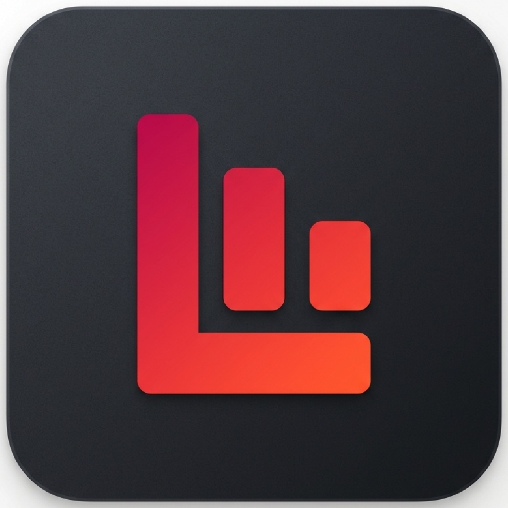

# Lilt Player (Rust)

Native Windows desktop player. It does not need Python or a Python runtime.

## Build

Install the stable Rust toolchain with the MSVC target and run `build-release.bat`.
The release script builds `target\release\lilt-player.exe`, a portable ZIP, and a per-user installer. Publish the MSI as the sole GitHub release asset; the executable and ZIP remain local build artifacts. The MSI installs Start Menu and Desktop shortcuts, registers Lilt as a selectable player for supported audio formats, and adds “Open folder with Lilt” to File Explorer's folder-background context menu. Windows still controls which app becomes the default. The Explorer integration is registered by the MSI and does not require Lilt to run at Windows log in.

Lilt checks GitHub for a newer published version quietly at startup. If one is available, it asks before downloading and opening the MSI installer. The user completes or cancels the Windows Installer prompts.

The release script installs WiX Toolset 7 locally if needed. WiX may ask the developer to accept its tool license on first setup; the Lilt MSI itself has no end-user license screen.

## Current features

- Background folder scanning, metadata, embedded album artwork, and library search
- Optional missing album-cover and artist-portrait lookup through MusicBrainz/Cover Art Archive and Wikimedia. It runs in the background, updates progress every 50 items, and caches results locally. Album lookup applies to supported audio files with artist/album metadata.
- Live typed search suggestions show at most five mixed song, artist, and album results with cover art; artist-name queries prioritize artist matches. Down enters results, Up returns to the search field, and Enter in the field opens grouped library search
- Ask AI opens a separate answer panel with a short response and matching songs at the end; it uses a configured Google AI key
- Optional AI library review can flag likely duplicate recordings and high-confidence artist-credit mistakes for manual review; it does not change tags automatically
- Home and Discover pages with personalized recommendations, genre and decade mixes, and artist radio
- Responsive File, Playback, View, Help, and Playlists menus in the title bar, with a grouped overflow menu on narrower windows; playlists remain available in the sidebar
- Larger YouTube Music-inspired layout with Songs, Albums, Artists, Likes, Playlists,
  History, Disliked, Lyrics, and Settings navigation
- Grid, details, and list views; Settings are grouped into Appearance, Playback, Library, Discover, AI, and Advanced sections, with Blue, Sky, Ice, Violet, Emerald, Rose, and Amber accent themes. Settings auto-save except sliders, which use Save slider changes. Other controls include discovery balance, recommendation variety and
  size, unplayed-song priority, and library folders
- Persistent song likes/dislikes, followed artists, saved albums, playlists, history, and preferences
- Home Recommendations and New to you shelves personalized from liked music and listening history,
  with controls for discovery balance, unplayed-song priority, variety, and mix size
- Queue panel with reordering, play/pause/next/previous, always-available keyboard navigation, broad shortcuts, shuffle, and repeat;
  album and artist collection shuffle randomizes the complete collection
- Expanded Now Playing view with album art, Up next, contextual For you picks, and one-click radio
  playback built from your library, listening history, likes, and current track
- Smart Mixes, listening statistics, a lightweight playback visualizer, and optional `.lrc` lyrics
- Mix Studio can use an optional Google AI Studio key stored in Windows Credential Manager to
  create short mood mixes or refresh recommendations on request from a limited set of song labels;
  AI-assisted recommendations are off by default, and no paths or audio are sent
- Mix Studio includes saved Liked, Played, and Unplayed library filters, full-library compact metadata,
  in-page model, thinking, mix-size, and opt-in recommendation controls, plus
  per-request and total token usage reported by Google; account quota links to Google AI Studio
- Optional Developer Output panel (off by default) and temporary error notifications for app status and troubleshooting
- Right-click track, album, artist, Home mix, or playlist items for playback, queueing, library,
  navigation, and collection actions; playlist menus also support rename and duplicate
- Windows multimedia keys for play/pause, next, previous, and stop, with current-track metadata
  shared with the system media overlay
- Show/Reveal in File Explorer opens the track's containing folder and selects the file
- Redesigned bottom player with clickable album art, clear like/dislike controls, and a seek timeline;
  album art opens the expanded player. Space/Ctrl+P toggles playback and Left/Right changes tracks
  when the app is focused and no text field is active; queued songs advance while unfocused
- Toolbar and navigation icons load from SVG assets at runtime
- Custom borderless title bar with `SupremyTommy` credit, responsive menus, window controls, drag-to-move, and edge resizing
- Fast eased page and search-panel movement alongside fades; motion can be disabled in Settings
- Optional “What’s new” release notes in the Help menu
- Animated startup credit splash for `SupremyTommy`
- `.lrc` sidecar lyrics display; removing a track from the library preserves its audio file
- Collaborative artist credits and album-title grouping, with placeholder artist/album metadata omitted

Settings and library preferences are stored in the user's application configuration directory.
The first launch prompts for a music folder; additional folders can be managed in Settings.

## Still to migrate

The Python app remains available in the parent folder. System tray and mini-player modes,
watched-folder rescanning, embedded-lyrics extraction, tag editing, duplicate detection, and the
advanced Python player features have not yet been ported to this Rust version.
